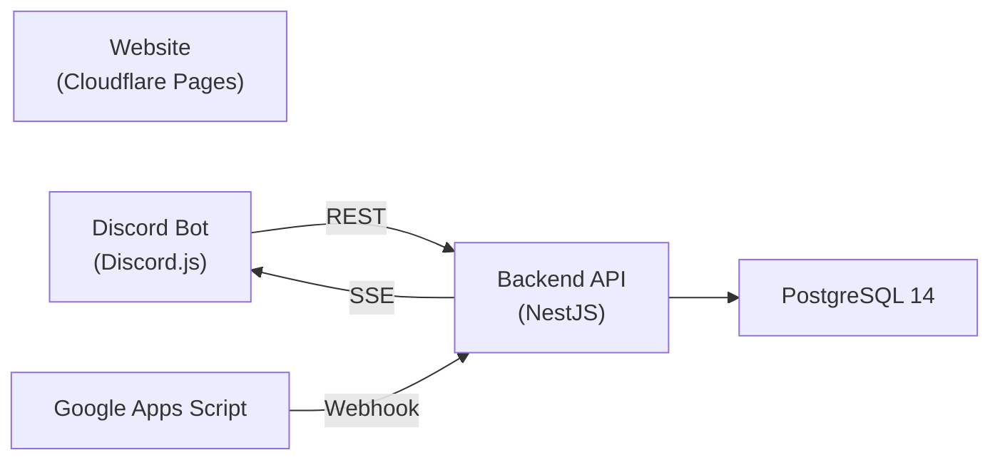

# [Texas A&M Esports Infrastructure](https://tamuesports.com/)

The technical infrastructure for Texas A&M Esports -- a full-stack system supporting 2,000+ members across 16 gaming titles and 30+ competitive teams.

## Architecture



| Component | Tech | Description |
|-----------|------|-------------|
| **Frontend** | React 18 + TypeScript | Static informational website at tamuesports.com |
| **Backend API** | NestJS + TypeORM | REST API handling all data operations |
| **Discord Bot** | Discord.js 14 | Member registration, dues claiming, admin tools, Twitch notifications |
| **Database** | PostgreSQL 14 | User data, confirmation codes, permissions, settings |
| **Membership Automation** | Google Apps Script | Processes Flywire dues payments via email |

## Quick Start

### Prerequisites

- [Git](https://git-scm.com/)
- [Node.js](https://nodejs.org/)
- [Docker](https://www.docker.com/)
- `.env.development` file (ask the lead developer)

### Setup

```bash
# Clone the repo
git clone <repo-url>

# Install dependencies
cd backend && npm install && cd ..
cd discord_bot && npm install && cd ..
cd frontend && npm install && cd ..

# Build and start development containers
npm run build:dev
npm run start:dev
```

### npm Scripts (Root)

| Script | Description |
|--------|-------------|
| `npm run start:dev` | Start dev containers (backend + bot) |
| `npm run start:prod` | Start production containers (backend + bot + postgres) |
| `npm run build:dev` | Build development Docker images |
| `npm run build:prod` | Build production Docker images |

## Hosting

| Service | Platform | URL |
|---------|----------|-----|
| Website | Cloudflare Pages | [tamuesports.com](https://tamuesports.com) |
| API | GCP Compute Engine | api.tamuesports.com |
| Database | GCP (Docker) | Port 5432 (IP-restricted) |
| Domain | Porkbun + Cloudflare DNS | tamuesports.com |

## Documentation

Detailed documentation lives in the [`/docs`](docs/) folder:

- **[Non-Technical Overview](docs/overview.md)** -- How the system works for non-technical officers
- **Technical Documentation** ([`docs/technical/`](docs/technical/)):
  - [System Architecture](docs/technical/architecture.md) -- High-level design, data flows, tech stack
  - [Backend API](docs/technical/backend.md) -- Entities, endpoints, auth, SSE
  - [Discord Bot](docs/technical/discord-bot.md) -- Commands, permissions, caching, Twitch
  - [Frontend](docs/technical/frontend.md) -- Pages, components, styling, deployment
  - [Database](docs/technical/database.md) -- Schema, tables, ER diagram, access control
  - [Infrastructure & Deployment](docs/technical/infrastructure.md) -- Docker, CI/CD, DNS, hosting
  - [Membership System](docs/technical/membership-system.md) -- End-to-end dues processing flow

## Development Workflow

1. Branch off `master` for new features
2. Develop locally with `npm run start:dev` (connects to the `dev` DB schema)
3. Create a pull request to `master`
4. On merge, GCP Cloud Build automatically builds new Docker images
5. SSH into the GCP Compute Engine instance and run `./update_deployment.sh` to deploy

When adding/modifying Discord slash commands, run `cd discord_bot && npm run deploy` to register them with the Discord API.
