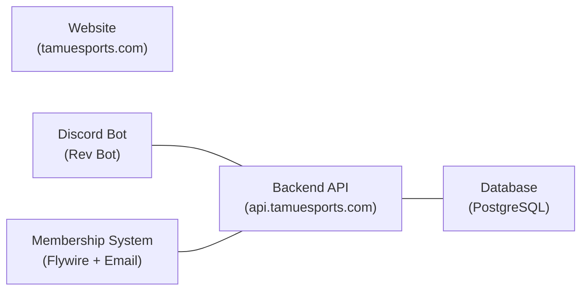
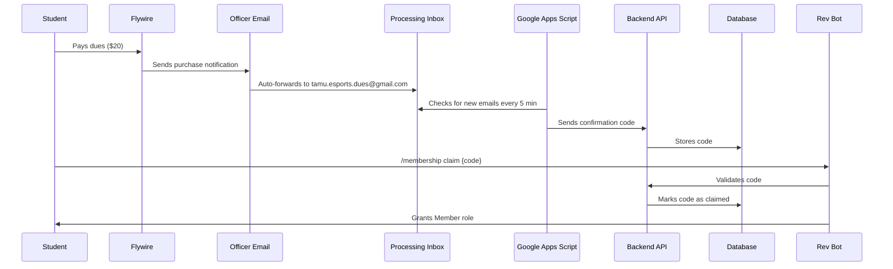

# TAMU Esports Infrastructure - Non-Technical Overview

## What Is This?

The Texas A&M Esports (AME) infrastructure is a collection of interconnected software systems that power the organization's online presence, community management, and membership operations. It serves over 2,000 members across 16+ gaming titles and 30+ competitive teams.

## The Big Picture

There are **five main pieces** that work together:

### 1. The Website (tamuesports.com)

The public-facing website for TAMU Esports. It provides:

- **Home Page** - Landing page with social media feeds and partner logos
- **About Page** - Mission, vision, leadership bios, events & activities, and FAQ
- **Contact Page** - Email addresses for different officers (president, VP, operations, competitive, development)
- **Members Page** - Information about how to become a member, dues, benefits, and step-by-step instructions
- **Shop** - Merchandise powered by Shopify

The website is hosted for free on **Cloudflare Pages** and automatically updates when code changes are pushed.

### 2. The Discord Bot (Rev Bot)

Rev Bot lives inside the TAMU Esports Discord server and is the primary way members and officers interact with the system. It handles:

- **User Registration** - Members create accounts by filling out a form with their UIN, name, and email
- **Membership Claiming** - After paying dues on Flywire, members enter their confirmation code to get the "Member" role
- **Admin Tools** - Officers can check membership status, view statistics, download reports, and manage permissions
- **Twitch Notifications** - Automatically posts in Discord when the TAMU Esports Twitch channel goes live
- **Server Management** - Purging inactive members, resetting memberships for new semesters, and managing settings
- **Permissions System** - Controls which Discord roles can use which admin commands

### 3. The Backend API

The "brain" that connects everything. It's a server that:

- Receives requests from the Discord bot and processes them
- Reads and writes data to the database
- Handles security (only authorized requests with valid API keys are allowed)
- Pushes real-time updates to the Discord bot when new dues are processed

Officers and members never interact with the API directly -- it works behind the scenes.

### 4. The Database

Stores all persistent data:

- **Users** - Registered member profiles (UIN, name, email, Discord ID)
- **Confirmation Codes** - Dues payment codes from Flywire
- **User-Code Links** - Which member claimed which confirmation code
- **Discord Settings** - Bot configuration (which roles to use, which channels, etc.)
- **Permissions** - Which Discord roles can execute which bot commands
- **API Keys** - Security tokens for authenticating with the backend

### 5. The Membership System

This is the automated dues processing pipeline. Here's how someone becomes a member:

**In plain English:**
1. A student pays their $20 dues on Flywire using their TAMU email
2. Flywire sends a notification email to a designated officer's TAMU email
3. That email is automatically forwarded to a processing inbox (tamu.esports.dues@gmail.com)
4. Every 5 minutes, an automated script checks for new emails, extracts the confirmation/order code, and sends it to the backend
5. The student then uses `/membership claim {code}` in Discord with their order number
6. Rev Bot verifies the code, marks it as used, and gives the student the Member role

## Key Accounts & Services

| Service | Purpose | Who Manages |
|---------|---------|-------------|
| **Flywire** (tamu.estore.flywire.com) | Dues payment processing | Officers |
| **Cloudflare** | Website hosting, domain DNS, custom email routing | Development team |
| **Google Cloud Platform (GCP)** | Server hosting for backend, bot, and database | Development team |
| **GitHub** | Source code repository and CI/CD | Development team |
| **Porkbun** | Domain registration (tamuesports.com) | Pierce Ray (rented) |
| **Shopify** | Merchandise store | Officers |

## Custom Email Addresses

These are managed through Cloudflare Email Routing and forward to individual officers:

- **president@tamuesports.com**
- **vicepresident@tamuesports.com**
- **competitive@tamuesports.com**
- **operations@tamuesports.com**
- **development@tamuesports.com**

Special-purpose emails:
- **tamu.esports.dues@gmail.com** - Automated dues processing inbox
- **tamu.esports.development@gmail.com** - Development team account (GCP, Google Apps Script)

## Common Officer Tasks

### Checking Membership Status
Use `/admin membership check_user @user` to see if someone has claimed their dues.

### Viewing Statistics
- `/stats count members` - How many people have paid dues
- `/stats count server_users` - Total Discord server members
- `/stats download members` - Download a spreadsheet of all members

### Semester Reset
At the start of each semester, use `/reset` to clear all memberships and confirmation codes. This removes the Member role from everyone so they need to re-purchase dues.

### Purging Inactive Members
Use `/purge {number}` to kick members who don't have a Student, Alumni, or Guest role.

### Reminding Members to Pay Dues
Use `/admin membership message_all` to send DMs to team members who haven't paid dues yet.

## Setting Up Dues Forwarding (When Officers Change)

This only needs to be done when the person with email forwarding set up graduates or loses TAMU email access:

### Flywire Setup
1. Log in to https://tamu.estore.flywire.com/admin
2. Go to the membership dues item
3. Go to the Notifications tab
4. Add the new officer's TAMU email address

### Email Forwarding Setup
1. Log into the new officer's TAMU email (Gmail)
2. Go to Settings > Forwarding and POP/IMAP
3. Add `tamu.esports.dues@gmail.com` as a forwarding address and verify it
4. Go to Settings > Filters and Blocked Addresses
5. Create a new filter: From = `noreply@tamu.edu`, Subject = `Product Purchase Notification`
6. Set the filter to forward matching emails to the processing inbox

## How to Become a Member (For Students)

1. Purchase dues on [Flywire](https://tamu.estore.flywire.com)
2. Wait up to 5 minutes for the system to process your payment
3. Join the TAMU Esports [Discord server](https://discord.gg/tamuesports)
4. Register with Rev Bot using `/profile register`
5. Claim your membership with `/membership claim {your_order_code}`
6. You should now have the Member role with access to member-only channels and benefits
