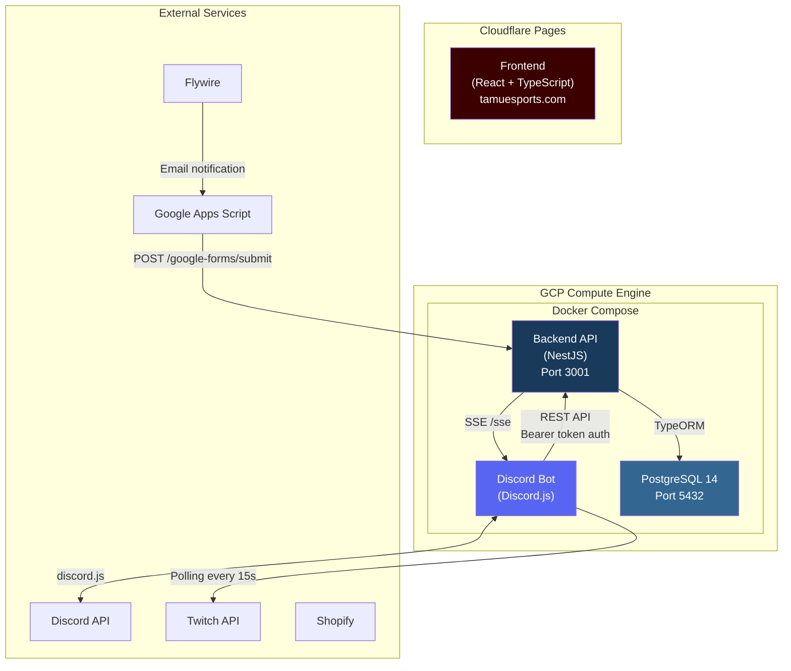
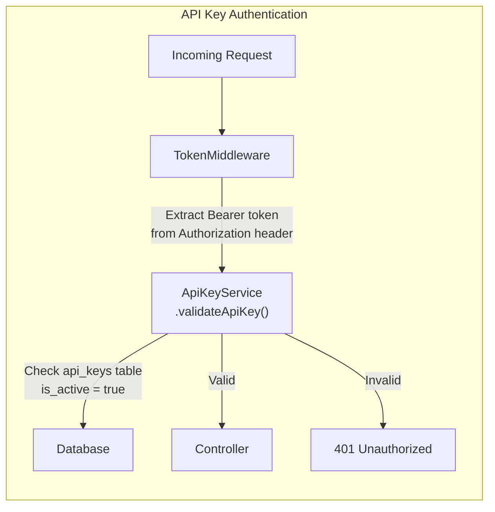
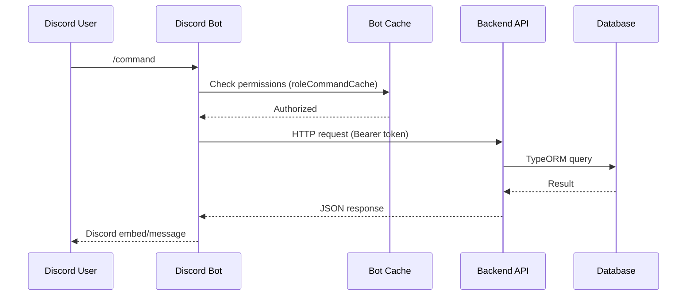
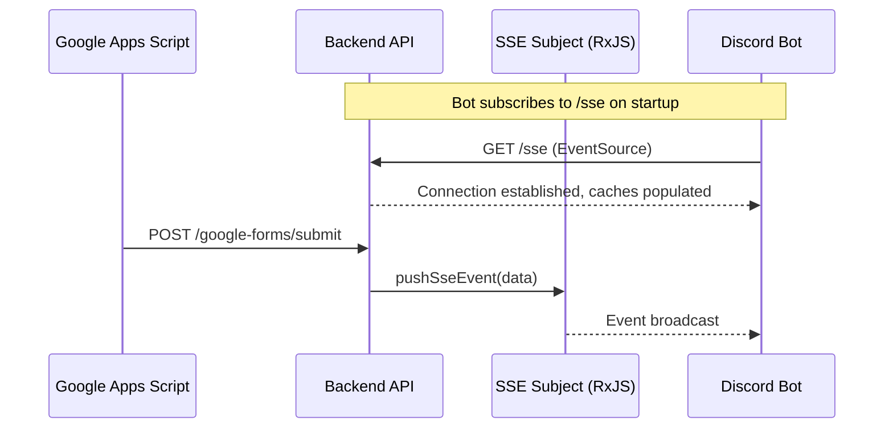
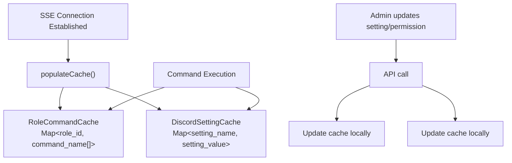

# System Architecture

## Overview

The TAMU Esports Infrastructure is a monorepo containing three primary services orchestrated via Docker Compose, plus a separately-hosted frontend. The system follows a service-oriented architecture where the Discord bot and external scripts communicate with a centralized NestJS API, which manages all database interactions.

## High-Level Architecture



## Service Communication

### Internal Communication (Docker Network)

All backend services communicate over a Docker bridge network called `app-network`:

| From | To | Protocol | Address |
|------|-----|----------|---------|
| Discord Bot | Backend API | HTTP REST | `http://backend:3001` |
| Backend API | PostgreSQL | TCP | `postgres:5432` |
| Discord Bot | Backend API | SSE | `http://backend:3001/sse` |

### External Communication

| From | To | Protocol | Purpose |
|------|-----|----------|---------|
| Discord Bot | Discord API | WebSocket + REST | Bot functionality |
| Discord Bot | Twitch API | HTTPS (polling) | Stream notifications |
| Google Apps Script | Backend API | HTTPS POST | Dues code submission |
| Backend API | Discord Bot | SSE | Real-time event push |
| Cloudflare | Users | HTTPS | Website serving |

## Authentication & Security



- **Protected endpoints**: All entity CRUD routes (users, confirmation codes, user codes, discord settings, role commands, QOTD leaderboard, API keys)
- **Unprotected endpoints**: `POST /google-forms/submit` (webhook for Google Apps Script), `GET /sse` (event stream)

## Data Flow Patterns

### 1. Discord Command Execution



### 2. Real-Time Updates via SSE



### 3. Bot Cache System

The Discord bot maintains two in-memory caches to reduce API calls:



**RoleCommandCache** stores permission mappings (which Discord roles can execute which commands). **DiscordSettingCache** stores bot configuration values (member role ID, notification channel, etc.).

## Technology Stack

| Layer | Technology | Version | Purpose |
|-------|-----------|---------|---------|
| Frontend | React + TypeScript | React 18, TS 4.9 | Public website |
| Frontend Styling | Bootstrap 5 + CSS Modules | 5.3.1 | Responsive design |
| Frontend Animation | Framer Motion | 10.16 | Scroll animations |
| Backend API | NestJS + TypeScript | NestJS 10 | REST API server |
| ORM | TypeORM | 0.3.x | Database abstraction |
| Database | PostgreSQL | 14 | Data persistence |
| Discord Bot | Discord.js + TypeScript | 14.11 | Bot framework |
| Containerization | Docker + Docker Compose | - | Service orchestration |
| CI/CD | GCP Cloud Build | - | Automated Docker image builds on push |
| Frontend Hosting | Cloudflare Pages | Free tier | Static site CDN |
| Server Hosting | GCP Compute Engine | Free tier | Backend services |
| Domain | Porkbun + Cloudflare DNS | - | tamuesports.com |

## Repository Structure

```
TAMU_Esports_Infrastructure/
├── backend/                         # NestJS API
│   ├── src/
│   │   ├── controllers/            # HTTP route handlers
│   │   ├── entities/               # TypeORM entity definitions
│   │   ├── filters/                # Exception handling
│   │   ├── middleware/             # API key authentication
│   │   ├── modules/               # NestJS module definitions
│   │   ├── services/              # Business logic
│   │   ├── app.module.ts          # Root module
│   │   ├── config.ts              # Environment config
│   │   └── main.ts                # Entry point
│   ├── Dockerfile.dev
│   ├── Dockerfile.prod
│   └── cloudbuild.yaml
├── discord_bot/                     # Discord.js Bot
│   ├── src/
│   │   ├── cache/                  # In-memory caches
│   │   ├── commands/               # Slash command handlers
│   │   │   ├── admin/             # Admin-only commands
│   │   │   └── general/           # Public commands
│   │   ├── models/                # Data type definitions
│   │   ├── services/              # API client services
│   │   ├── utilities/             # Helpers and shared logic
│   │   ├── bot.ts                 # Entry point
│   │   └── deploy-commands.ts     # Command registration script
│   ├── Dockerfile.dev
│   ├── Dockerfile.prod
│   └── cloudbuild.yaml
├── frontend/                        # React Website
│   ├── src/
│   │   ├── assets/                # Images and branding
│   │   ├── components/            # Reusable UI components
│   │   ├── pages/                 # Route page components
│   │   ├── styles/                # Global/shared CSS
│   │   ├── App.tsx                # Router and layout
│   │   └── index.tsx              # Entry point
│   └── Dockerfile
├── docker-compose.yml              # Development orchestration
├── docker-compose.prod.yml         # Production orchestration
├── .env.development                # Dev environment variables
├── .env.production                 # Prod environment variables
└── package.json                    # Root-level npm scripts
```

## Environment Configuration

The project uses environment files at the root level that are injected into Docker containers:

| Variable | Component | Purpose |
|----------|-----------|---------|
| `DISCORD_TOKEN` | Bot | Discord bot authentication |
| `CLIENT_ID` / `GUILD_ID` | Bot | Discord application + server IDs |
| `TWITCH_CLIENT_ID` / `TWITCH_CLIENT_SECRET` | Bot | Twitch API access |
| `BACKEND_DISCORD_TOKEN` | Bot + API | API key for bot-to-API auth |
| `DB_HOST` / `DB_PORT` / `DB_USERNAME` / `DB_PASSWORD` | API | Database connection |
| `DB_DATABASE` / `DB_SCHEMA` | API | Database + schema selection |
| `JWT_SECRET` | API | Token signing |

Key difference between environments:
- **Development**: `DB_HOST` points to AWS RDS, `DB_SCHEMA = dev`
- **Production**: `DB_HOST = postgres` (Docker service name), `DB_SCHEMA = public`

## Domain & DNS

- **tamuesports.com** - Main website (Cloudflare Pages)
- **api.tamuesports.com** - Backend API (GCP Compute Engine)
- Custom email addresses route through Cloudflare Email Routing to officer TAMU emails
