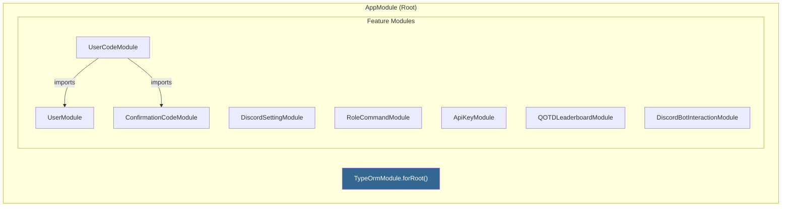

# Backend API

## Overview

The backend is a **NestJS** application (TypeScript) that serves as the central data layer for the entire system. It exposes a REST API consumed primarily by the Discord bot, and also receives webhook calls from Google Apps Script for dues processing. It manages all database interactions through TypeORM and provides real-time event streaming via Server-Sent Events (SSE).

**Runtime**: Node.js 18 (production) / Node.js 19 (development)
**Port**: 3001
**Base URL**: `https://api.tamuesports.com` (production) / `http://localhost:3001` (development)

## Module Architecture

NestJS uses a modular architecture. Each domain has its own module containing an entity, service, and controller:



Each feature module follows the pattern:

```
Module
├── Entity        (TypeORM entity - maps to DB table)
├── Service       (Business logic - CRUD operations)
└── Controller    (HTTP routes - request/response handling)
```

**Special module**: `DiscordBotInteractionModule` contains the SSE service, SSE controller, and Google Forms controller. It has no entity -- it manages in-memory event streams via RxJS.

## Entities

### User (`users` table)

| Column | Type | Constraints | Description |
|--------|------|-------------|-------------|
| `uin` | varchar(255) | **PK** | Student UIN |
| `first_name` | varchar(255) | | Student first name |
| `last_name` | varchar(255) | | Student last name |
| `email` | varchar(255) | | Student email |
| `discord_id` | varchar(255) | | Discord user ID |
| `has_paid_dues` | boolean | default: false | Whether user has paid dues |

### ConfirmationCode (`confirmation_codes` table)

| Column | Type | Constraints | Description |
|--------|------|-------------|-------------|
| `code` | string | **PK** | Flywire order/confirmation code |
| `claimed` | boolean | default: false | Whether code has been claimed |

### UserCode (`user_codes` table)

| Column | Type | Constraints | Description |
|--------|------|-------------|-------------|
| `uin` | string | **PK**, FK -> users | Student UIN |
| `code` | string | **PK**, FK -> confirmation_codes | Confirmation code |

This is a junction table linking users to their claimed confirmation codes. Has ManyToOne relationships to both User and ConfirmationCode.

### DiscordSetting (`discord_settings` table)

| Column | Type | Constraints | Description |
|--------|------|-------------|-------------|
| `id` | int | **PK**, auto-increment | Setting ID |
| `name` | varchar(255) | | Setting name (e.g., `member_role`) |
| `value` | varchar(255) | | Setting value (typically a Discord ID) |

### RoleCommand (`role_commands` table)

| Column | Type | Constraints | Description |
|--------|------|-------------|-------------|
| `id` | int | **PK**, auto-increment | Permission ID |
| `role_id` | varchar(255) | | Discord role ID |
| `command_name` | varchar(255) | | Command path (e.g., `admin membership check_user`) |

### ApiKey (`api_keys` table)

| Column | Type | Constraints | Description |
|--------|------|-------------|-------------|
| `id` | int | **PK**, auto-increment | Key ID |
| `api_key` | varchar(255) | unique | The API key value |
| `description` | varchar(255) | | What this key is used for |
| `created_at` | timestamp | default: CURRENT_TIMESTAMP | Creation date |
| `is_active` | boolean | default: true | Whether key is active |

### QOTDEntry (`qotd_leaderboard` table)

| Column | Type | Constraints | Description |
|--------|------|-------------|-------------|
| `discord_id` | string | **PK** | Discord user ID |
| `score` | number | | Leaderboard score |

## API Endpoints

### User Controller (`/users`)

| Method | Route | Description |
|--------|-------|-------------|
| `POST` | `/users` | Create new user |
| `GET` | `/users` | Get all users |
| `GET` | `/users/reset` | Get Discord IDs of users with paid dues (for semester reset) |
| `GET` | `/users/:uin` | Get user by UIN |
| `GET` | `/users/discord/:id` | Get user by Discord ID |
| `DELETE` | `/users/:uin` | Delete user by UIN |
| `DELETE` | `/users/discord/:id` | Delete user by Discord ID |
| `PUT` | `/users/:uin` | Update user by UIN |
| `PUT` | `/users/discord/:id` | Update user by Discord ID |

### ConfirmationCode Controller (`/confirmation_codes`)

| Method | Route | Description |
|--------|-------|-------------|
| `POST` | `/confirmation_codes` | Create a confirmation code |
| `GET` | `/confirmation_codes` | Get all codes |
| `GET` | `/confirmation_codes/:code` | Get specific code |
| `DELETE` | `/confirmation_codes/reset` | Delete all codes (semester reset) |
| `DELETE` | `/confirmation_codes/:code` | Delete specific code |
| `PUT` | `/confirmation_codes/:code` | Update code (mark as claimed) |

### UserCode Controller (`/user_codes`)

| Method | Route | Description |
|--------|-------|-------------|
| `POST` | `/user_codes` | Create membership link (user + code) |
| `GET` | `/user_codes` | Get all memberships |
| `GET` | `/user_codes/user/:uin` | Get memberships by user |
| `GET` | `/user_codes/code/:code` | Get memberships by code |
| `GET` | `/user_codes/:uin/:code` | Get specific membership |
| `DELETE` | `/user_codes/reset` | Delete all memberships (semester reset) |
| `DELETE` | `/user_codes/:uin/:code` | Delete specific membership |
| `DELETE` | `/user_codes/:uin` | Delete all memberships for user |
| `PUT` | `/user_codes/:uin/:code` | Update membership |

### DiscordSetting Controller (`/discord_settings`)

| Method | Route | Description |
|--------|-------|-------------|
| `POST` | `/discord_settings` | Create setting |
| `GET` | `/discord_settings` | Get all settings |
| `GET` | `/discord_settings/:id` | Get setting by ID |
| `DELETE` | `/discord_settings/:id` | Delete setting |
| `PUT` | `/discord_settings/:id` | Update setting by ID |
| `PUT` | `/discord_settings/name/:name` | Update setting by name |

### RoleCommand Controller (`/role_commands`)

| Method | Route | Description |
|--------|-------|-------------|
| `POST` | `/role_commands` | Create permission |
| `GET` | `/role_commands` | Get all permissions |
| `GET` | `/role_commands/:id` | Get permission by ID |
| `DELETE` | `/role_commands/:id` | Delete by ID |
| `DELETE` | `/role_commands/:role_id/:command_name` | Delete by role + command |
| `PUT` | `/role_commands/:id` | Update permission |

### ApiKey Controller (`/api_keys`)

| Method | Route | Description |
|--------|-------|-------------|
| `POST` | `/api_keys` | Create API key |
| `GET` | `/api_keys` | Get all API keys |
| `GET` | `/api_keys/:id` | Get API key by ID |
| `DELETE` | `/api_keys/:id` | Delete API key |
| `PUT` | `/api_keys/:id` | Update API key |

### QOTDLeaderboard Controller (`/qotd_leader`)

| Method | Route | Description |
|--------|-------|-------------|
| `POST` | `/qotd_leader` | Create leaderboard entry |
| `GET` | `/qotd_leader` | Get all entries |
| `GET` | `/qotd_leader/:discord_id` | Get entry by Discord ID |
| `DELETE` | `/qotd_leader/:discord_id` | Delete entry |
| `PUT` | `/qotd_leader/:discord_id` | Update entry |

### SSE & Webhook Controllers

| Method | Route | Auth | Description |
|--------|-------|------|-------------|
| `GET` | `/sse` | None | SSE event stream subscription |
| `POST` | `/google-forms/submit` | None | Webhook for Google Apps Script |

## Authentication Middleware

The `TokenMiddleware` protects most API routes:

1. Extracts the Bearer token from the `Authorization` header
2. Calls `ApiKeyService.validateApiKey()` to check the token against the `api_keys` table
3. Verifies the key exists and `is_active = true`
4. Returns `401 Unauthorized` if invalid

**Excluded from auth**: `/sse` and `/google-forms/submit` endpoints (no middleware applied).

The middleware is configured in `AppModule.configure()` and applied to specific controller paths.

## Server-Sent Events (SSE)

The SSE system enables real-time communication from the API to the Discord bot:

- **SseService** uses an RxJS `Subject<SseMessageEvent>` to manage the event stream
- **SseController** exposes `GET /sse` using NestJS's `@Sse()` decorator, returning an Observable
- **GoogleFormsController** triggers events via `POST /google-forms/submit`, calling `sseService.pushSseEvent(data)`

When the Discord bot connects to `/sse`, it establishes a persistent connection and receives events as they occur (e.g., when new dues codes are submitted).

## Error Handling

A global `HttpExceptionFilter` catches all exceptions and returns standardized JSON responses:

```json
{
  "statusCode": 404,
  "timestamp": "2024-01-15T12:00:00.000Z",
  "path": "/users/12345",
  "message": "User not found"
}
```

## Configuration

Environment variables are loaded via `dotenv` in `src/config.ts`:

| Variable | Description |
|----------|-------------|
| `DB_HOST` | PostgreSQL host |
| `DB_PORT` | PostgreSQL port |
| `DB_USERNAME` | Database username |
| `DB_PASSWORD` | Database password |
| `DB_DATABASE` | Database name |
| `DB_SCHEMA` | Schema (`public` for prod, `dev` for development) |

## Docker

### Development (`Dockerfile.dev`)
- Node 19, installs all dependencies, runs `npm run start:dev` (NestJS watch mode)
- Source code mounted as volume for hot-reload

### Production (`Dockerfile.prod`)
- Multi-stage build: Node 18-alpine
- Stage 1: Compile TypeScript to `dist/`
- Stage 2: Copy compiled code + production dependencies only
- Runs as non-root user (`appuser`)
- Entry: `node dist/main.js`

### Cloud Build (`cloudbuild.yaml`)
- Builds production Docker image
- Pushes to: `us-central1-docker.pkg.dev/$PROJECT_ID/backend/backend:latest`

## Key Dependencies

| Package | Purpose |
|---------|---------|
| `@nestjs/core` | NestJS framework |
| `@nestjs/typeorm` | TypeORM integration |
| `typeorm` | ORM for PostgreSQL |
| `pg` | PostgreSQL driver |
| `class-validator` | DTO validation |
| `rxjs` | SSE event streaming |
| `dotenv` | Environment variable loading |
