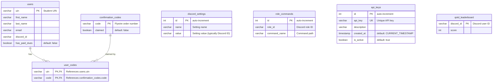

# Database

## Overview

The database is a **PostgreSQL 14** instance that serves as the central data store for the entire TAMU Esports infrastructure. It stores user registrations, membership confirmation codes, bot configuration, permissions, and API keys.

## Hosting

- **Production**: Runs as a Docker container (`postgres:14` official image) alongside the backend and Discord bot, orchestrated by Docker Compose on a GCP Compute Engine instance
- **Development**: Developers connect to the production database but use the `dev` schema, keeping development data isolated from production

## Schemas

| Schema | Purpose | Access |
|--------|---------|--------|
| `public` | Production data used by live services | Lead developer: full access |
| `dev` | Development/testing copy | All developers: full access |

The schema is selected via the `DB_SCHEMA` environment variable (`public` for production, `dev` for development).

## Entity Relationship Diagram

## Tables

### `users`
Stores registered member profiles. The primary key is the student's UIN, and each user is also associated with a Discord ID for bot interactions.

### `confirmation_codes`
Stores Flywire order/confirmation codes submitted by the Google Apps Script automation. Each code has a `claimed` boolean that flips to `true` when a user claims it.

### `user_codes`
Junction table linking users to their claimed confirmation codes. Composite primary key of `(uin, code)`. This is the definitive record of who has active membership.

### `discord_settings`
Key-value store for bot configuration. Settings include role IDs (member, student, alumni, guest, bot), channel IDs (Twitch notification channel), and other configurable values.

**Common settings:**

| Name | Description |
|------|-------------|
| `member_role` | Role ID given to members who claim dues |
| `student_role` | Student status role |
| `alumni_role` | Alumni role (purge exemption) |
| `guest_role` | Guest role (purge exemption) |
| `bot_role` | Forbidden onboarding role (auto-kick trigger) |
| `twitch_notif_channel` | Channel for Twitch notifications |
| `twitch_notif_role` | Role pinged for Twitch |

### `role_commands`
Maps Discord role IDs to command names, forming the permission system. Supports wildcard entries (e.g., `admin *` grants access to all admin subcommands).

### `api_keys`
Stores API keys used for authenticating requests to the backend. Keys can be deactivated by setting `is_active = false`.

### `qotd_leaderboard`
Stores Question of the Day scores per Discord user. Maps Discord user IDs to their accumulated score.

## Access Control

- **Network**: Access requires IP whitelisting in the GCP firewall for TCP on port 5432
- **Lead Developer**: Full read/write access to both `public` and `dev` schemas
- **Developers**: Read-only access to `public`, full access to `dev`
- **Services**: Backend API connects via TypeORM using credentials from environment variables

## ORM

The backend uses **TypeORM** to interact with the database:
- Each table maps to a TypeORM Entity class in `backend/src/entities/`
- Repositories are auto-injected via `TypeOrmModule.forFeature()` in each NestJS module
- Supports DataMapper pattern for async CRUD operations
- Connection configured in `AppModule` via `TypeOrmModule.forRoot()` with env variables

## Backup & Data Safety

- PostgreSQL data persists in a Docker volume (`pgdata`) on the production server
- The `dev` schema provides an isolated sandbox for testing without risk to production data
- Semester resets (via `/reset` command) clear `user_codes` and `confirmation_codes` tables but preserve user registrations
