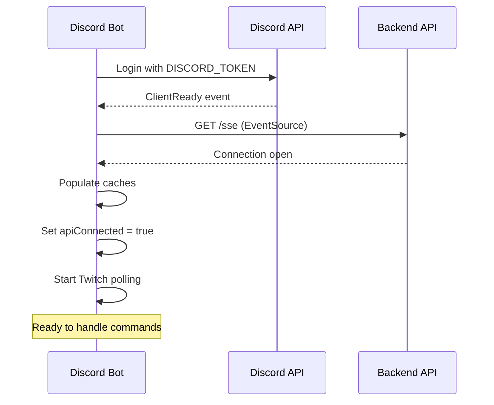
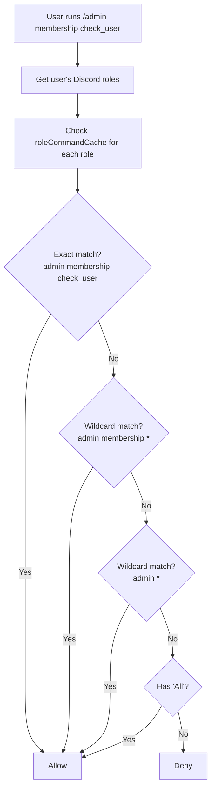

# Discord Bot (Rev Bot)

## Overview

Rev Bot is a Discord.js v14 bot that serves as the primary interface for members and officers to interact with the TAMU Esports system. It handles user registration, membership claiming, admin operations, Twitch stream notifications, and permission-based command access.

**Framework**: Discord.js 14.11
**Runtime**: Node.js 18 (production) / Node.js 19 (development)
**Entry Point**: `src/bot.ts`

## Bot Initialization

When the bot starts (`bot.ts`), it:

1. Creates a Discord.js `Client` with intents for Guilds, GuildMembers, GuildPresences, GuildModeration, DirectMessages, GuildMessages, and reactions
2. Loads all slash commands from the commands index
3. Connects to the backend SSE endpoint (`/sse`) to establish real-time updates
4. On SSE connection, populates the in-memory caches (permissions and settings)
5. Sets `apiConnected = true` once the SSE connection is established (commands are blocked until this flag is true)
6. Starts Twitch polling on `ClientReady`

## Command Structure

Commands are organized in `src/commands/` and exported through an index file. Each command file exports:
- `data`: A `SlashCommandBuilder` defining the command name, description, and options
- `execute(interaction)`: The handler function

### General Commands (Any User)

#### `/ping`
Simple health check, replies "Pong!" (ephemeral).

#### `/profile info`
Displays the user's registered account information as a Discord embed.

#### `/profile permissions`
Lists which commands the user has permission to execute based on their Discord roles.

#### `/profile register`
Opens a modal form for registration with fields: UIN, First Name, Last Name, Email. Creates a user record via the backend API.

#### `/profile edit`
Opens a modal to edit existing profile information.

#### `/profile unregister`
Deletes the user's registration (currently disabled in code).

#### `/membership claim <code>`
Claims membership using a Flywire confirmation code. Flow:
1. Verifies user is registered
2. Validates confirmation code exists
3. Adds the Member role to the user
4. Creates a user-code link in the database

#### `/wompwomp <messagelink>`
Fun command that adds custom emoji reactions to a specified message.

### Admin Commands (Permission-Gated)

#### `/admin membership check_user <user>`
Checks if a specific user has claimed a confirmation code (is a member).

#### `/admin membership check_code <code>`
Checks if a confirmation code exists and whether it's been claimed.

#### `/admin membership check_all [role]`
Generates a CSV of team members (with Student role) who don't have the Member role. Optionally filter by a specific team role.

#### `/admin membership message_all [role]`
Sends DMs to all unpaid team members reminding them to purchase and claim dues.

#### `/admin membership create_code <user>`
Creates a financial aid confirmation code for a user (format: `username_financialaid`).

#### `/admin users get <user>`
Displays another user's profile information.

#### `/permissions add <role> <command>`
Grants a Discord role permission to execute a specific command or command group.

#### `/permissions remove <role> <command>`
Revokes a specific command permission from a role.

#### `/permissions remove_all <role>`
Removes all permissions from a role.

#### `/permissions check <role>`
Lists all commands a role has permission to execute.

#### `/settings get [setting_name]`
Retrieves one or all bot settings.

#### `/settings update <setting_name> <new_value>`
Updates an existing setting value.

#### `/settings create <setting_name> <value>`
Creates a new setting.

#### `/stats count <stat_name>`
Returns counts for: `members`, `users`, `server_users`, `purgable`, `dues_purchased`.

#### `/stats download <stat_name>`
Exports CSV files for: `members`, `users`, `purgable`, `dues_purchased`. Each includes different columns relevant to the stat type.

#### `/purge <number_of_people>`
Kicks N users who don't have Student, Alumni, or Guest roles. Sends each user a DM with a server invite link before kicking.

#### `/reset`
Semester reset: clears all user-code links, deletes all confirmation codes, and removes the Member role from all users with a 1-second delay between each removal.

## Permission System

Permissions control which Discord roles can execute which admin commands. They are stored as `RoleCommand` entries with a `role_id` and `command_name`.

### Wildcard Matching

The system supports wildcards for flexible permission grants:

| Permission Entry | Grants Access To |
|-----------------|------------------|
| `admin membership check_user` | Only `/admin membership check_user` |
| `admin membership *` | All `/admin membership` subcommands |
| `admin *` | All `/admin` commands and subcommands |
| `All` | Every command |

### Check Flow

## Cache System

Two singleton caches reduce API calls and speed up command processing:

### RoleCommandCache
- **Structure**: `Map<role_id, string[]>` (role ID -> array of command names)
- **Populated**: On SSE connection from backend
- **Updated**: When permissions are added/removed via commands
- **Used by**: Permission check on every command execution

### DiscordSettingCache
- **Structure**: `Map<setting_name, setting_value>` (all values are strings)
- **Populated**: On SSE connection from backend
- **Updated**: When settings are changed via commands
- **Key settings**:

| Setting Name | Purpose |
|-------------|---------|
| `member_role` | Role ID granted when claiming membership |
| `student_role` | Student status role (for dues checking) |
| `alumni_role` | Alumni role (purge exemption) |
| `guest_role` | Guest role (purge exemption) |
| `bot_role` | Forbidden onboarding role (triggers auto-kick) |
| `twitch_notif_channel` | Channel for Twitch live notifications |
| `twitch_notif_role` | Role pinged for Twitch notifications |

## Service Layer

Each service wraps Axios HTTP calls to the backend API. All requests include `Authorization: Bearer {BACKEND_DISCORD_TOKEN}`.

| Service | Base URL | Purpose |
|---------|----------|---------|
| `userService` | `/users` | User CRUD operations |
| `userCodeService` | `/user_codes` | Membership link management |
| `confirmationCodeService` | `/confirmation_codes` | Dues code management |
| `roleCommandService` | `/role_commands` | Permission management |
| `discordSettingService` | `/discord_settings` | Bot settings management |
| `qotdLeaderboardService` | `/qotd_leader` | QOTD leaderboard (has a bug: incorrect baseURL) |
| `twitchService` | Twitch API | Stream status polling |

All services use centralized error handling via `utilities/axiosErrorHandling.ts`, which extracts meaningful error messages from Axios response errors.

## Event Handling

### Discord Events

| Event | Handler |
|-------|---------|
| `ClientReady` | Start Twitch polling |
| `InteractionCreate` (command) | Permission check -> rate limit check -> execute command |
| `InteractionCreate` (modal) | Handle registration/edit form submissions |
| `MessageCreate` | Respond "Howdy!" when mentioned with "howdy" |
| `GuildMemberRemove` | Clean up user data when member leaves/is kicked |
| `GuildMemberUpdate` | Auto-kick users who receive the forbidden `bot_role` |

### Rate Limiting

Commands are rate-limited to **5 executions per 1 minute per user**. Exceeding this returns an ephemeral warning message.

### SSE Events

The bot subscribes to the backend's `/sse` endpoint using the `eventsource` library. Events received trigger cache updates or other real-time reactions.

## Twitch Integration

Implemented in `services/twitchService.ts`:

- Polls the Twitch API every **15 seconds** for the `tamuesports` channel
- When the stream goes live, sends an embed to the configured notification channel
- Pings the `twitch_notif_role` role in the notification message
- Uses an `isLiveMemory` flag to prevent duplicate notifications per stream session
- Embed includes: stream title, thumbnail image, link to Twitch channel

## Membership Utilities

Key functions in `utilities/membership.ts`:

### `giveMembership(guild, member, code)`
1. Fetch user by Discord ID (must be registered)
2. Validate confirmation code exists
3. Get `member_role` from settings cache
4. Add role to Discord member
5. Create user-code link in database

### `removeMembership(guild, member)`
1. Fetch user by Discord ID
2. Remove member role from Discord member
3. Delete user-code entry from database

### `getUnpaidDuesList(guild, specificRole?)`
Returns a `Map<User, Role[]>` of users who have a team role AND the student role but NOT the member role. Team roles are identified by the pattern `/^Team\s\w+/` (excluding "Team Captain", "Team Fight Tactics", "Team Manager").

## Modal Handling

Two modals are handled in `bot.ts` for interactive forms:

- **Register Modal** (`customId: 'register'`): Collects UIN, first name, last name, email and creates a new user via the API
- **Edit Modal** (`customId: 'edit'`): Collects the same fields and updates the existing user record

## Command Deployment

`src/deploy-commands.ts` is a standalone script that registers slash commands with the Discord API. Run manually via `npm run deploy` when commands are added or modified.

## Docker

### Development (`Dockerfile.dev`)
- Node 19, runs `npm run dev` (nodemon + ts-node for hot-reload)
- Source code mounted as volume

### Production (`Dockerfile.prod`)
- Multi-stage build with Node 18-alpine
- Compiles TypeScript to `dist/`
- Runs as non-root user (`appuser`)
- Entry: `node dist/bot.js`

### Cloud Build (`cloudbuild.yaml`)
- Pushes to: `us-central1-docker.pkg.dev/$PROJECT_ID/discord-bot/discord-bot:latest`

## Key Dependencies

| Package | Purpose |
|---------|---------|
| `discord.js` | Discord API framework |
| `axios` | HTTP client for backend API |
| `eventsource` | SSE client for real-time updates |
| `node-twitch` | Twitch API wrapper |
| `dotenv` | Environment variable loading |
| `nodemon` / `ts-node` | Development hot-reload |
