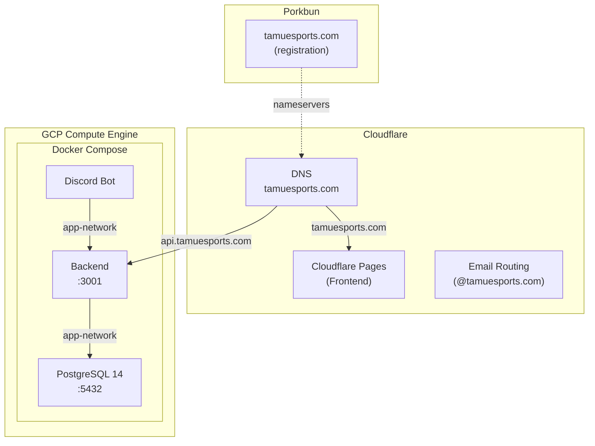
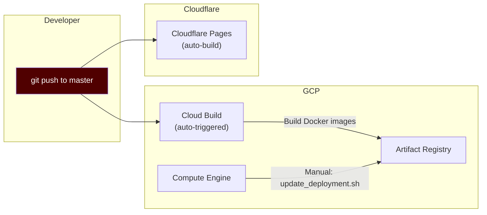

# Infrastructure & Deployment

## Overview

The TAMU Esports infrastructure uses Docker containers orchestrated by Docker Compose, hosted on a GCP Compute Engine instance (free tier). The frontend is separately hosted on Cloudflare Pages. Docker image builds are automated via GCP Cloud Build (triggered on push to master), and deployment to the server is done manually by running a script over SSH.

## Hosting Architecture



## Docker Compose

### Development (`docker-compose.yml`)

Two services with live source code mounting for hot-reload:

| Service | Port | Dockerfile | Notes |
|---------|------|------------|-------|
| `backend` | 3001:3001 | `Dockerfile.dev` | NestJS watch mode |
| `discord_bot` | none | `Dockerfile.dev` | Nodemon + ts-node |

- Network: `app-network` (bridge)
- Env file: `.env.development`
- Volumes: Source directories mounted into containers (`./backend:/app`, `./discord_bot:/app`)
- No database container -- development connects to the production DB's `dev` schema

### Production (`docker-compose.prod.yml`)

Three services using pre-built images from Google Artifact Registry:

| Service | Port | Image Source | Restart |
|---------|------|-------------|---------|
| `backend` | 3001:3001 | GCR artifact registry | `unless-stopped` |
| `discord_bot` | none | GCR artifact registry | `unless-stopped` |
| `postgres` | 5432:5432 | `postgres:14` official | `unless-stopped` |

- Network: `app-network` (bridge)
- Env file: `.env.production`
- Dependencies: bot depends on backend + postgres; backend depends on postgres
- Volume: `pgdata` for PostgreSQL data persistence

### Root npm Scripts

```bash
npm run start:dev   # docker-compose -f docker-compose.yml --env-file .env.development up
npm run start:prod  # docker-compose -f docker-compose.prod.yml --env-file .env.production up
npm run build:dev   # Build development Docker images
npm run build:prod  # Build production Docker images
```

## CI/CD Pipeline



### Backend & Bot Build (Automatic)

GCP Cloud Build is connected directly to the GitHub repository (`ConnorB26/TAMU_Esports_Infrastructure`). Two build triggers are configured:

| Trigger | Event | Config File |
|---------|-------|-------------|
| `backend-build-trigger` | Push to branch | `backend/cloudbuild.yaml` |
| `discord-bot-build-trigger` | Push to branch | `discord_bot/cloudbuild.yaml` |

On push to master, Cloud Build automatically:
1. Builds Docker images for backend and Discord bot using their respective `Dockerfile.prod` files
2. Pushes the images to Google Artifact Registry

**Backend image**: `us-central1-docker.pkg.dev/$PROJECT_ID/backend/backend:latest`
**Discord Bot image**: `us-central1-docker.pkg.dev/$PROJECT_ID/discord-bot/discord-bot:latest`
**Build logs**: `gs://tamu-esports-infrastructure-build-logs-bucket`

### Backend & Bot Deployment (Manual)

Deployment to the server is a **manual step**. After Cloud Build finishes building the new images:

1. SSH into the GCP Compute Engine instance (via the GCP Console > Compute Engine > SSH button)
2. Run the deployment script:
   ```bash
   ./update_deployment.sh
   ```

The `update_deployment.sh` script does the following:
1. `cd` into the repo directory (`./TAMU_Esports_Infrastructure`)
2. `git pull` to get the latest code
3. `docker compose pull` to pull the latest images from Artifact Registry
4. `docker compose down` to stop current containers
5. `docker compose up -d` to start updated containers

### Frontend Deployment (Automatic)

Cloudflare Pages is directly connected to the GitHub repository. On push to `master`, Cloudflare automatically:
1. Builds the React app
2. Deploys to its CDN
3. Preview builds available at `tamu-esports.pages.dev`

## Docker Build Strategy

### Development Dockerfiles
- Single-stage builds for fast iteration
- Node 19 base image
- All dependencies installed (dev + production)
- Source code mounted as volumes (not copied)
- Hot-reload via watch mode (NestJS watch / nodemon)

### Production Dockerfiles
- **Multi-stage builds** for optimized images:
  - **Stage 1 (Builder)**: Node 18-alpine, installs deps, compiles TypeScript to `dist/`
  - **Stage 2 (Runtime)**: Node 18-alpine, copies only compiled code + production deps
- Non-root user (`appuser:appgroup`) for security
- Alpine base for minimal image size
- No development dependencies in final image

## Environment Variables

### How Env Files Are Used

The project has three env files, each serving a different purpose:

| File | Used By | When |
|------|---------|------|
| `.env.development` | Docker Compose (dev) | Local development -- injected into containers via `env_file:` and also mounted as `/app/.env` so `dotenv.config()` can read it directly |
| `.env.production` | Root npm scripts only | Used locally when running `npm run start:prod` |
| `discord_bot/.env` | `dotenv.config()` directly | Running scripts outside Docker (e.g. `npm run deploy` for slash command registration) |

**On the server**, `docker-compose.prod.yml` specifies `env_file: .env` (no prefix), which resolves to a plain `.env` at the repo root. This file is **not committed to git** on the server -- it must be manually created there with the production values. It is the single source of truth for all three containers (backend, discord_bot, postgres) in production.

### Env File Template

All environments use the same variables; only a few values differ. Ask the lead developer for actual values.

```env
# Discord Bot
DISCORD_TOKEN=<bot token from Discord Developer Portal>
DISCORD_CLIENT_ID=<application client id>
DISCORD_CLIENT_SECRET=<application client secret>
DISCORD_GUILD_ID=<discord server id>

# Twitch Integration
TWITCH_CLIENT_ID=<twitch app client id>
TWITCH_CLIENT_SECRET=<twitch app client secret>

# Database
DB_HOST=<hostname>           # "postgres" in prod, RDS endpoint in dev
DB_PORT=5432
DB_USERNAME=postgres
DB_PASSWORD=<db password>
DB_DATABASE=Infrastructure
DB_SCHEMA=<schema>           # "public" in prod, "dev" in development
POSTGRES_PASSWORD=<password> # prod only -- initializes the postgres container

# API Authentication
BACKEND_DISCORD_TOKEN=<uuid -- must match a valid entry in the api_keys table>
JWT_SECRET=<random secret string>
```

### Key Differences Between Environments

| Variable | Development | Production (server) |
|----------|------------|---------------------|
| `DB_HOST` | AWS RDS hostname | `postgres` (Docker service name) |
| `DB_SCHEMA` | `dev` | `public` |
| `DISCORD_TOKEN` | Dev bot token | Prod bot token |
| `DISCORD_CLIENT_ID` | Dev application ID | Prod application ID |
| `POSTGRES_PASSWORD` | Not needed (external DB) | Required (initializes the container) |

## Domain & DNS

### Domain Registration
- **Registrar**: Porkbun (rented by Pierce Ray)
- **Nameservers**: Pointed to Cloudflare for DNS management

### DNS Records (Cloudflare)
- `tamuesports.com` -> Cloudflare Pages (website)
- `api.tamuesports.com` -> GCP Compute Engine IP (backend API)

### Email Routing (Cloudflare)
Custom `@tamuesports.com` addresses forward to officer TAMU emails:

| Address | Forwards To |
|---------|------------|
| president@tamuesports.com | Officer's TAMU email |
| vicepresident@tamuesports.com | Officer's TAMU email |
| competitive@tamuesports.com | Officer's TAMU email |
| operations@tamuesports.com | Officer's TAMU email |
| development@tamuesports.com | Officer's TAMU email |

These are managed in Cloudflare under **Email Routing** and should be updated when officers change.

## Server Access

The GCP Compute Engine instance is accessed by:
1. Logging into GCP with the `tamu.esports.development@gmail.com` account
2. Navigating to Compute Engine
3. Clicking SSH on the instance

Direct SSH access requires the private key stored in GitHub Secrets.

## Network Ports

| Port | Service | External Access |
|------|---------|----------------|
| 3001 | Backend API | Yes (via api.tamuesports.com) |
| 5432 | PostgreSQL | Restricted (IP whitelist in GCP firewall) |
| 443 | Frontend (Cloudflare) | Yes (tamuesports.com) |

## Development Workflow

### Local Setup
1. Clone the repository
2. Get `.env.development` from the lead developer
3. Run `npm install` in backend, frontend, and discord_bot directories
4. Run `npm run build:dev` then `npm run start:dev`
5. Docker Compose starts backend + bot with hot-reload

### Feature Branch Workflow
1. Branch off from `master` (or a development branch) for new features
2. Develop and test locally using the `dev` database schema
3. Create a pull request back to the target branch
4. On merge to `master`, CI/CD automatically builds and deploys

### Deploying Command Changes
When Discord slash commands are added or modified, run the deploy script manually:
```bash
cd discord_bot
npm run deploy
```
This registers the updated commands with the Discord API.
