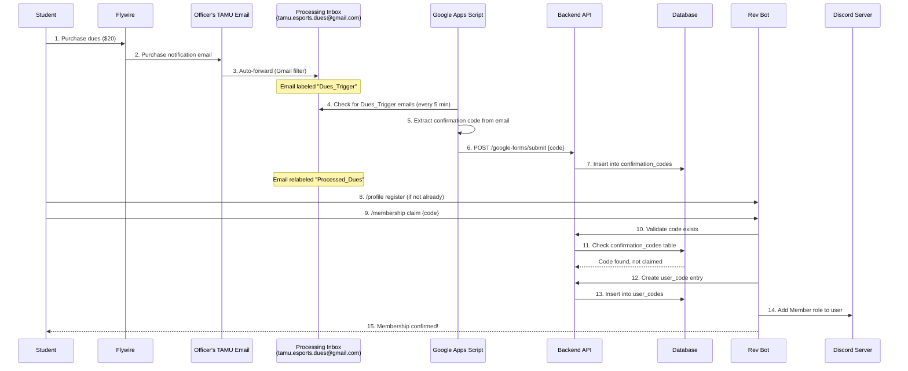
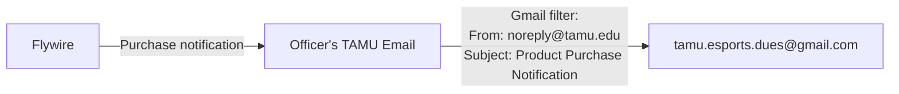
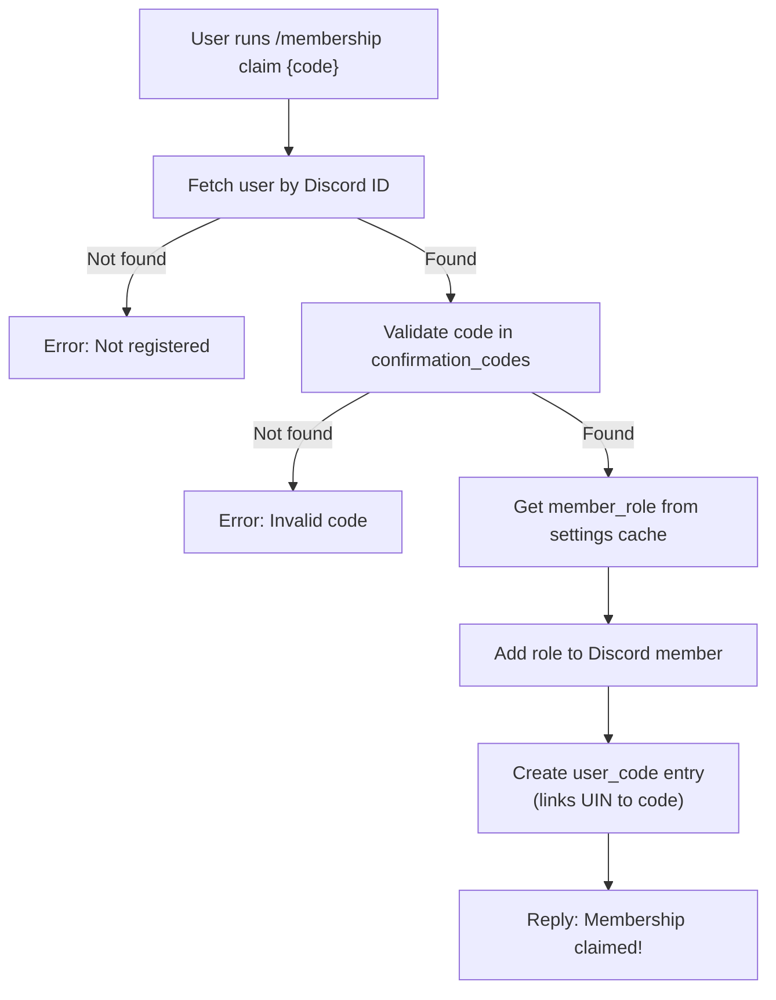

# Membership System

## Overview

The membership system is the most complex workflow in the TAMU Esports infrastructure. It automates the process of collecting dues payments via Flywire, processing confirmation codes through email automation, and allowing members to claim their membership status via the Discord bot. This document covers the end-to-end flow, all involved components, and setup procedures.

## End-to-End Flow

## Components Involved

### 1. Flywire (Payment Processor)
- **URL**: https://tamu.estore.flywire.com
- Processes $20 membership dues
- Sends purchase notification emails to configured TAMU email addresses
- Only supports TAMU email addresses for notifications (no external emails)

### 2. Email Forwarding Chain
A designated officer's TAMU email receives Flywire notifications and auto-forwards them:

The Gmail filter matches:
- **From**: `noreply@tamu.edu`
- **Subject**: `Product Purchase Notification`

### 3. Google Apps Script (Automation)
- **Location**: Logged in as tamu.esports.development@gmail.com at https://script.google.com/
- **Schedule**: Runs every 5 minutes
- **Process**:
  1. Fetches all emails with the `Dues_Trigger` label
  2. Extracts the order/confirmation code from each email body
  3. Sends the code to the backend API via `POST /google-forms/submit`
  4. Relabels processed emails as `Processed_Dues` to prevent re-processing
- **Recovery**: A separate recovery script can process codes within a specified date range if the automation missed any

### 4. Backend API
- **Webhook endpoint**: `POST /google-forms/submit` (no authentication required)
- Receives confirmation codes from Google Apps Script
- Pushes SSE events to notify connected clients
- Also provides CRUD endpoints for `confirmation_codes` and `user_codes` tables

### 5. Database Tables

Three tables are central to membership:

| Table | Key Fields | Purpose |
|-------|-----------|---------|
| `confirmation_codes` | `code` (PK), `claimed` (bool) | Stores all Flywire order codes |
| `users` | `uin` (PK), `discord_id`, `has_paid_dues` | Registered user accounts |
| `user_codes` | `uin` (FK), `code` (FK) | Links users to their claimed codes |

### 6. Discord Bot Commands

| Command | Who | Description |
|---------|-----|-------------|
| `/profile register` | Members | Register account (prerequisite for claiming) |
| `/membership claim {code}` | Members | Claim dues with confirmation code |
| `/admin membership check_user {user}` | Officers | Check if user has membership |
| `/admin membership check_code {code}` | Officers | Check if code is claimed |
| `/admin membership check_all [role]` | Officers | CSV of unpaid team members |
| `/admin membership message_all [role]` | Officers | DM unpaid team members |
| `/admin membership create_code {user}` | Officers | Create financial aid code |

## Claiming Process (Detailed)

When a user runs `/membership claim {code}`, the bot executes `giveMembership()`:

## Unclaiming / Removal

`removeMembership()` reverses the process:
1. Fetch user by Discord ID
2. Get member role from cache
3. Remove role from Discord member
4. Delete user-code entry from database

This is triggered when:
- A user is purged or leaves the server (`GuildMemberRemove` event)
- An admin manually removes membership

## Unpaid Members Detection

The `getUnpaidDuesList()` utility identifies members who should have paid but haven't:

**Criteria**: Has a team role matching `/^Team\s\w+/` AND has the Student role, but does NOT have the Member role.

**Excluded patterns**: "Team Captain", "Team Fight Tactics", "Team Manager" (these are not competitive team roles).

This powers the `/admin membership check_all` and `/admin membership message_all` commands.

## Financial Aid Codes

Officers can create manual confirmation codes for students on financial aid:
- Command: `/admin membership create_code {user}`
- Format: `{username}_financialaid`
- These codes bypass the Flywire payment flow

## Semester Reset

At the start of each semester, the `/reset` command:
1. Deletes all entries in the `user_codes` table
2. Deletes all entries in the `confirmation_codes` table
3. Removes the Member role from all Discord users (with 1-second delays between removals to avoid rate limiting)

**Important**: User registrations (`users` table) are preserved across resets. Members only need to re-purchase and re-claim dues each semester.

## Setup & Maintenance

### Initial Setup (One-Time)
These are already configured and only need changes when officers rotate:

1. **Google Apps Script**: Running under `tamu.esports.development@gmail.com`
2. **Processing inbox**: `tamu.esports.dues@gmail.com`
3. **Email labels**: `Dues_Trigger` and `Processed_Dues` in the processing inbox

### When Officers Change (Email Forwarding)

This is needed when the person with the forwarding setup graduates or loses TAMU email access:

#### Flywire Configuration
1. Login to https://tamu.estore.flywire.com/admin
2. Navigate to the membership dues item
3. Go to the Notifications tab
4. Add the new officer's TAMU email address

#### Gmail Forwarding Setup
1. Login to the new officer's TAMU email (Gmail)
2. Settings > Forwarding and POP/IMAP
3. Add `tamu.esports.dues@gmail.com` as a forwarding address
4. Verify with the confirmation code sent to the processing inbox
5. Settings > Filters and Blocked Addresses
6. Create filter: From = `noreply@tamu.edu`, Subject = `Product Purchase Notification`
7. Action: Forward to processing inbox

### Troubleshooting

| Issue | Possible Cause | Solution |
|-------|---------------|----------|
| Codes not appearing | Google Apps Script stopped | Check script execution logs, re-run manually |
| Codes not appearing | Email forwarding broken | Verify Gmail filter and forwarding settings |
| Code exists but claim fails | Code already claimed | Check with `/admin membership check_code` |
| User can't claim | Not registered | User needs to run `/profile register` first |
| Batch of codes missed | Script downtime | Use recovery script with date range |
